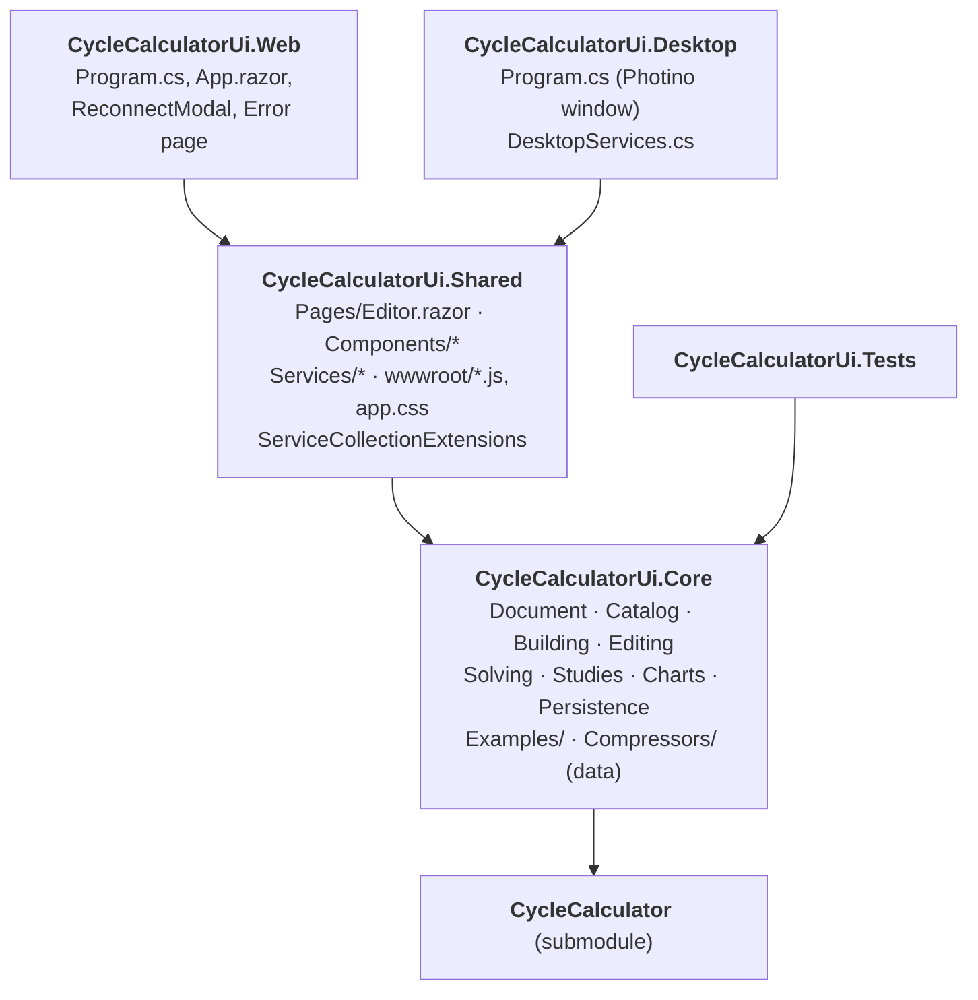

# 1 · Architecture

> **Summary.** Five projects in `CycleCalculatorUi.sln`, each referencing only the layer below: two thin
> hosts (Web, Desktop), a shared Razor UI library, a UI-free Core library holding all logic, and the
> backend submodule. Both hosts call `AddCycleEditor()`; the desktop host swaps in native file dialogs and
> a file-based draft store. All projects target .NET 10.

**Contents**
- [Projects](#projects)
- [Why Blazor Server and not WebAssembly](#why-blazor-server-and-not-webassembly)
- [Dependency injection](#dependency-injection)
- [Web vs desktop host](#web-vs-desktop-host)
- [Static assets and JavaScript modules](#static-assets-and-javascript-modules)
- [Core namespaces at a glance](#core-namespaces-at-a-glance)

---

## Projects



| Project | Role | Notes |
|---------|------|-------|
| `CycleCalculatorUi.Web` | Web host | Blazor Server, interactive server render mode |
| `CycleCalculatorUi.Desktop` | Desktop host | Photino.Blazor WebView window (1440×900). Needs webkit2gtk-4.1 on Linux |
| `CycleCalculatorUi.Shared` | All UI | Razor components + three JS modules; host-agnostic |
| `CycleCalculatorUi.Core` | All logic | No UI dependencies; everything the tests exercise |
| `CycleCalculator` | Solver | Separate git repository, see [backend docs](../CycleCalculator/docs/README.md) |
| `CycleCalculatorUi.Tests` | Tests | NUnit, references Core only |

**Gotcha.** The backend csproj references NUnit packages, so the app projects set `IsTestProject=false`
and `GenerateTestingPlatformEntryPoint=false`. Keep both when adding new executables.

## Why Blazor Server and not WebAssembly

CoolProp is a native library called through P/Invoke. It cannot run inside the browser, so the solver
must run on a server process — Blazor Server on the web, a local .NET process on the desktop. The UI is the
same Razor code in both cases.

## Dependency injection

Both hosts call `services.AddCycleEditor(...)` from `Shared/ServiceCollectionExtensions.cs`:

| Service | Lifetime | Notes |
|---------|----------|-------|
| `ExampleLibrary` | Singleton | Watches the examples folder |
| `CompressorLibrary` | Singleton | Watches the compressor folder |
| `ComponentCatalog` | Singleton | `ComponentCatalog.WithLibrary(compressorLibrary)` |
| `SolveService` | Singleton | Shared concurrency limit across all users |
| `EditorState` | **Scoped** | One per web circuit (browser tab) / per desktop window |
| `IFileService` | Scoped, `TryAdd` | Default `BrowserFileService` |
| `IDraftStore` | Scoped, `TryAdd` | Default `BrowserDraftStore` |

Because the last two use `TryAdd`, a host that registers its own implementation **before** calling
`AddCycleEditor` wins. The desktop host does exactly that.

`AddCycleEditor(solveOptions, compressorLibraryDirectory, exampleDirectory)` — all optional. Neither host
passes `SolveOptions`, so the defaults apply (see [Solving](05-solving-and-results.md#solveservice)).

## Web vs desktop host

| | Web | Desktop |
|---|-----|---------|
| Runtime | Blazor Server (SignalR circuit per tab) | Photino.Blazor WebView, in-process |
| Open file | `<InputFile>` upload (≤ 10 MB) | Native dialog (`DesktopFileService`), remembers last folder |
| Save file | Browser download via `host.js` | Native save dialog, adds extension, defaults to Documents |
| Draft | Browser `localStorage` (key `cyclecalculator.draft`) | `<AppData>/CycleCalculator/draft.cycle.json`, atomic write via `.tmp` + move |
| Library folders | Configurable: `CompressorLibrary:Directory`, `Examples:Directory` (appsettings or env vars `CompressorLibrary__Directory`, …) | Always the shipped folders next to the program |
| Errors | Error page + Blazor reconnect modal | Unhandled exceptions shown in a message dialog |
| Dev URLs | http://localhost:5098, https://localhost:7078 | – |

`IFileService.HasOpenDialog` tells the UI which open mechanism to show; `Ctrl+O` only works on desktop.

## Static assets and JavaScript modules

Shared's `wwwroot/` holds `diagram.js`, `phchart.js`, `host.js` and `app.css`. Components load the
modules with:

```csharp
await JS.InvokeAsync<IJSObjectReference>("import", "./_content/CycleCalculatorUi.Shared/diagram.js");
```

- **Web:** `MapStaticAssets()` serves `_content/CycleCalculatorUi.Shared/*` automatically.
- **Desktop:** Photino only serves the output `wwwroot`. The Desktop csproj target
  `CopySharedStaticAssets` (after Build) copies Shared's `wwwroot/**` into
  `$(OutDir)wwwroot/_content/CycleCalculatorUi.Shared/`.

If a JS change does not show up on desktop, rebuild so the copy step runs.

## Core namespaces at a glance

| Folder | Responsibility | Key types | Docs |
|--------|----------------|-----------|------|
| `Document/` | The editor's model | `SystemDocument`, `NodeModel`, `ConnectionModel`, `DocumentBuilder` | [2](02-document-model.md) |
| `Catalog/` | What each component type is | `ComponentDescriptor`, `ParameterDescriptor`, `BuiltInComponents`, `Measurements`, `CompressorLibrary` | [3](03-catalog.md), [7](07-libraries.md) |
| `Building/` | Document → backend | `ModelBuilder`, `ConnectionRules`, `FluidCircuitResolver`, `StartGuesses` | [4](04-editing-and-validation.md), [5](05-solving-and-results.md) |
| `Editing/` | The single edit entry point | `EditorState` | [4](04-editing-and-validation.md) |
| `Solving/` | Running solves, interpreting results | `SolveService`, `SolveResult`, `EnergyBalance`, `FlowDirection` | [5](05-solving-and-results.md) |
| `Charts/` | p-h diagram data | `PhDiagramBuilder` | [5](05-solving-and-results.md#p-h-diagram) |
| `Studies/` | Parametric studies | `StudyDefinition`, `StudyRunner` | [6](06-studies.md) |
| `Persistence/` | `.cycle.json` | `DocumentSerializer` | [2](02-document-model.md) |
| `Examples/` | Example systems | `ExampleLibrary` | [7](07-libraries.md) |
