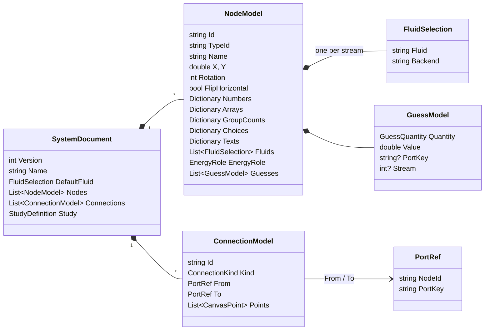
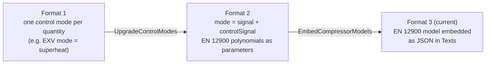

# 2 · Document Model and File Format

> **Summary.** The editor's state is a `SystemDocument`: a name, a default fluid, a list of `NodeModel`s
> (placed components with typed parameter dictionaries) and a list of `ConnectionModel`s (fluid or signal).
> It holds no backend objects. Documents are saved as indented camelCase JSON (`.cycle.json`) by
> `DocumentSerializer`, which also migrates older formats on load and computes the *fingerprint* used to
> detect stale results. Current format version: **3**.

**Contents**
- [Model overview](#model-overview)
- [SystemDocument](#systemdocument)
- [NodeModel](#nodemodel)
- [ConnectionModel](#connectionmodel)
- [Repeat groups](#repeat-groups)
- [Start guesses](#start-guesses)
- [The .cycle.json file](#the-cyclejson-file)
- [Versions and migrations](#versions-and-migrations)
- [Fingerprint](#fingerprint)
- [DocumentBuilder (for tests)](#documentbuilder-for-tests)

---

## Model overview



All types live in `Core/Document/SystemDocument.cs`.

## SystemDocument

| Property | Meaning |
|----------|---------|
| `Version` | File format version (`CurrentVersion = 3`) |
| `Name` | System name; also the default file name and browser tab title |
| `DefaultFluid` | Fluid given to streams not yet connected to anything with a fluid (default CO₂ / HEOS) |
| `Nodes`, `Connections` | The drawing |
| `Study` | Optional parametric study setup; does not affect single calculations |

## NodeModel

Parameter values are stored in **typed dictionaries keyed by the parameter key** from the catalog:

| Dictionary | Holds | Notes |
|------------|-------|-------|
| `Numbers` | numeric parameters | `null` = "empty / free for the solver" for optional parameters |
| `Arrays` | coefficient lists (e.g. pump curves) | |
| `Choices` | choice parameters (modes, models) | string values, e.g. `"mode": "signal"` |
| `Texts` | embedded data | e.g. the whole EN 12900 compressor model as JSON under the `model` key |
| `GroupCounts` | number of items per repeat group | missing = group minimum |

Other fields:

- `TypeId` is the backend class name (`"ExpansionValve"`), used to look up the descriptor.
- `Fluids` has one `FluidSelection` per stream (two for heat exchangers).
- `EnergyRole` overrides how the node counts in the energy totals (`Auto` follows its type).
- `Rotation`/`FlipHorizontal`/`X`/`Y` are layout only.

## ConnectionModel

- **Fluid** connections are normalised to run **outlet → inlet** (`From` is the outlet).
- **Signal** connections run **source → signal input**: `From` is the measured fluid port or a signal
  output; `To` is the controller's signal input.
- `Points` are the corners of a route the user shaped by dragging (canvas units). `null` = automatic
  routing.

## Repeat groups

Some components hold several copies of a parameter set — e.g. an EN 12900 node with three compressors in
parallel, or a signal operator with four inputs.

```
Item 1  →  plain keys:     "model", "speedControl", "operatingFrequency"
Item 2  →  "model#2", "speedControl#2", "operatingFrequency#2"
Item 3  →  "model#3", …
Count   →  GroupCounts["compressors"] = 3
```

- Helpers: `RepeatGroupDescriptor.ItemKey(key, index)` and `RepeatGroupDescriptor.Parse(key)`.
- **Ports** can repeat too (`PortDescriptor.Group`): `In`, `In#2`, `In#3`… spread along the edge.
- When touching stored values, iterate `ComponentDescriptor.ParameterInstances(node)` (not `Parameters`),
  and use `PortsFor(node)` / `FindPort(node, key)` for ports.
- `EditorState.RemoveGroupItem` shifts later items' values, ports, connections and study variables up by
  one; `AddGroupItem` copies the last item. Connections to ports a node no longer has are dropped.

## Start guesses

`GuessModel(Quantity, Value, PortKey?, Stream?)` is a solver start guess (see
[backend: start values](../CycleCalculator/docs/04-solver.md#3-start-values)). Scope:

| `PortKey` | `Stream` | Applies to |
|-----------|----------|------------|
| set | – | one port (mass flow positive into the component) |
| null | set | the fluid ports of one stream |
| null | null | the whole component (mass flow = throughput) |

`Building/StartGuesses.cs` validates them and can create them from a previous result (`FromResult`).

## The .cycle.json file

Serialised with System.Text.Json: camelCase, indented, enums as strings, nulls written. An abbreviated
example:

```jsonc
{
  "version": 3,
  "name": "LP ejector system with two pumps",
  "defaultFluid": { "fluid": "CarbonDioxide", "backend": "HEOS" },
  "nodes": [
    {
      "id": "e8a2914b20ec",
      "typeId": "ExpansionValve",
      "name": "EXV2",
      "x": 1184, "y": 448, "rotation": 0, "flipHorizontal": true,
      "numbers": {
        "outletPressure": 35,
        "superheatSetpoint": 5,
        "minOutletPressure": null,          // empty = component default
        "maxOutletPressure": null
      },
      "arrays": {}, "groupCounts": {},
      "choices": { "mode": "signal", "controlSignal": "superheat" },
      "texts": {},
      "fluids": [ { "fluid": "CarbonDioxide", "backend": "HEOS" } ],
      "energyRole": "Auto",
      "guesses": []
    }
    // …
  ],
  "connections": [
    {
      "id": "64321dffda37",
      "kind": "Fluid",
      "from": { "nodeId": "a92ffeb38203", "portKey": "OutletLiquid" },
      "to":   { "nodeId": "e8a2914b20ec", "portKey": "Inlet" },
      "points": [ { "x": 1096, "y": 240 }, { "x": 1096, "y": 312 } ]
    }
  ],
  "study": {
    "variables": [
      { "nodeId": "f46b98ee558e", "parameterKey": "pressureSetpoint",
        "start": 2.02, "end": 2.299, "steps": 5, "spacing": "Linear" }
    ],
    "outputs": [],
    "warmStart": true
  }
}
```

API (`Persistence/DocumentSerializer.cs`):

| Method | Purpose |
|--------|---------|
| `Serialize(document)` | JSON text |
| `Deserialize(json)` | Parses and migrates. Throws `InvalidDataException` for unreadable files or **newer** versions |
| `Clone(document)` | Deep copy via a JSON round trip (migrations run again — harmless) |
| `Fingerprint(document)` | See below |

**Rule: keep old files loadable.** Any change to the format needs a migration step.

## Versions and migrations



On every load `Upgrade()` runs (idempotent):

- **Control modes (format 1):** per-quantity modes (`temperature`, `superheat`, `massFlow`) on expansion
  valves, three-way valves and effectiveness heat exchangers become `mode = "signal"` plus
  `controlSignal`. `targetTemperatureSetpoint` is renamed `temperatureSetpoint` (study variables too);
  study outputs named "X error" become "Control error"; `pumpEnvelope` becomes `Pump.envelopePosition`.
- **EN 12900 speed control:** compressors without `speedControl` get `variable` if an operating frequency
  is set, else `fixed`.

For version < 3, `EmbedCompressorModels()` converts the old per-compressor polynomial parameters (with
node-wide units, discharge variable and superheat) into an embedded compressor model with fixed and
linear-scaling variable variants, then removes the old keys and their study variables. Results stay the
same.

## Fingerprint

`DocumentSerializer.Fingerprint(document)` = first 8 bytes of SHA-256 over the compact JSON of a copy
with everything that does **not** affect the calculation blanked out:

| Excluded | Why |
|----------|-----|
| `Name` | cosmetic |
| `Study` | only changes how results are summarised |
| node `X`, `Y`, `Rotation`, `FlipHorizontal` | layout |
| node `EnergyRole` | only changes the energy totals |
| connection `Points` | route shape |

Every `SolveResult` stores the fingerprint of the document it solved; when the current document's
fingerprint differs, the result is shown as stale.

## DocumentBuilder (for tests)

`Document/DocumentBuilder.cs` builds documents in code (tests, quick experiments). `Add` creates a node
with the descriptor's defaults (`ComponentDescriptor.CreateNode`) and overrides the given numbers:

```csharp
var fluid = new FluidSelection(CoolPropFluids.CarbonDioxide, CoolPropBackends.HEOS);
var b = new DocumentBuilder(ComponentCatalog.Default, "Simple cycle", fluid);

NodeModel comp = b.Add("SimpleCompressor", "Comp1", 0, 0, ("dischargePressure", 90), ("massFlow", 1));
NodeModel gc   = b.Add("TemperatureBoundary", "GC", 200, 0, ("outletTemperature", 30));
NodeModel exv  = b.Add("ExpansionValve", "EXV", 200, 200, ("outletPressure", 30));
NodeModel evap = b.Add("TemperatureBoundary", "Evap", 0, 200, ("outletTemperature", 0));

SystemDocument doc = b
    .Choice(exv, "mode", "fixed")
    .Connect(comp, "Outlet", gc, "Inlet")
    .Connect(gc, "Outlet", exv, "Inlet")
    .Connect(exv, "Outlet", evap, "Inlet")
    .Connect(evap, "Outlet", comp, "Inlet")
    .Build();
```
