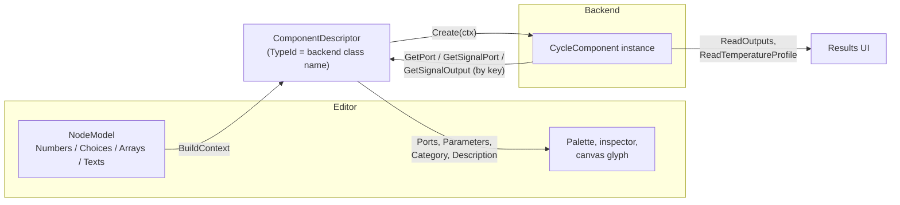

# 3 · Component Catalog

> **Summary.** The catalog (`Core/Catalog/`) tells the editor everything about each component type:
> palette entry, ports and where they sit on the symbol, editable parameters (with units, ranges, modes and
> help), how to build the backend component, which results to show, and how it counts in the energy
> balance. There are 16 built-in descriptors in `BuiltInComponents.cs`. Adding a backend component to the
> editor takes one descriptor plus one glyph.

**Contents**
- [How a descriptor connects editor and backend](#how-a-descriptor-connects-editor-and-backend)
- [ComponentDescriptor](#componentdescriptor)
- [PortDescriptor](#portdescriptor)
- [ParameterDescriptor](#parameterdescriptor)
- [EnergyKind](#energykind)
- [Built-in components](#built-in-components)
- [Controllers: shared signal-control parameters](#controllers-shared-signal-control-parameters)
- [Measured quantities](#measured-quantities)
- [Fluids](#fluids)
- [Recipe: adding a backend component](#recipe-adding-a-backend-component)
- [Recipe: making an exposed value measurable](#recipe-making-an-exposed-value-measurable)

---

## How a descriptor connects editor and backend



`ComponentCatalog` holds the descriptors:

- `ComponentCatalog.Default` — built-ins with an **empty** compressor library (tests, examples).
- `ComponentCatalog.WithLibrary(library)` — what the hosts use.
- `Find(typeId)` / `Get(typeId)`.

## ComponentDescriptor

| Member | Purpose |
|--------|---------|
| `TypeId` | Backend class name, stored in `NodeModel.TypeId` |
| `DisplayName`, `Category`, `Description`, `NamePrefix` | Palette and inspector text; new nodes are named `<prefix>1`, `<prefix>2`… |
| `Streams`, `StreamDefaults` | Stream labels (e.g. `["Hot", "Cold"]`) and optional default fluid per stream |
| `Ports` | `PortDescriptor`s (see below) |
| `Parameters`, `RepeatGroups` | `ParameterDescriptor`s and `RepeatGroupDescriptor`s |
| `Initialize` | Extra set-up of a new node, e.g. choose the first library compressor |
| `Create` | `Func<BuildContext, CycleComponent>` — builds the backend component; throws for invalid parameters |
| `GetPort`, `GetSignalPort`, `GetSignalOutput` | Map a port key to the backend object |
| `ReadOutputs` | Component results (`OutputValue(Label, Value, Unit)`) after a solve |
| `ReadTemperatureProfile` | For heat exchangers: the T–Q profile |
| `EnergyKind` | How it counts in heat/power totals — **set it or it won't appear** |
| `Check` | Extra validation beyond parameter ranges |

Helpers: `CreateNode(name, x, y, fluid)`, `PortsFor(node)`, `FindPort(node, key)`, `FindParameter(key)`,
`FindGroup(key)`, `ParameterInstances(node)`.

`BuildContext` gives typed access while creating: `c.Name`, `c.Fluid(stream)`, `c.Backend(stream)`,
`c.Number(key)` (required), `c.OptionalNumber(key)` (null if empty or inactive), `c.Choice(key)`,
`c.Coefficients(key)`, `c.Count(groupKey)`. A missing required value throws `ParameterException(key, …)`,
which the builder turns into an issue on that input field.

The `Typed` helper keeps the mappings short:

```csharp
GetPort     = Typed.Ports<Pipe>(("Inlet", p => p.Inlet), ("Outlet", p => p.Outlet)),
ReadOutputs = Typed.Outputs<Pipe>(p => [new OutputValue("Pressure drop", p.PressureDrop, "bar")])
```

## PortDescriptor

```csharp
new PortDescriptor(Key, Label, Kind, Direction, Stream, X, Y)
```

| Field | Meaning |
|-------|---------|
| `Kind` | `Fluid`, `SignalInput` or `SignalOutput` |
| `Direction` | `Inlet`, `Outlet`, `Undefined` (boundaries, signals) |
| `Stream` | Which stream (0 or 1) the port belongs to |
| `X`, `Y` | Anchor on the symbol, 0–1 of its width/height (0, 0.5 = middle of the left edge) |
| `IsRequired` | Optional predicate; by default fluid ports must be connected, signal inputs only when the node is controlled |
| `Group` | Repeat with a group: keys `In`, `In#2`, … spread along the edge |
| `CheckSource` | For signal inputs: is this source acceptable? (e.g. "a pump envelope position must measure a pump") |

## ParameterDescriptor

```csharp
new ParameterDescriptor("nominalPressureDrop", "Nominal pressure drop", ParameterKind.Number)
{
    Unit = "bar", DefaultNumber = 0.5, Min = 0,
    Help = "Pressure drop at the nominal mass flow. Zero gives an ideal pipe."
}
```

| Member | Meaning |
|--------|---------|
| `Kind` | `Number`, `Choice` or `Coefficients` (fixed-length list, `Length`, `CoefficientLabels`) |
| `Unit`, `DefaultNumber` / `DefaultChoice` / `DefaultCoefficients` | |
| `Optional` | May be left empty — "free for the solver" |
| `Min`, `Max`, `MinExclusive` | Validated on every edit |
| `Options` / `OptionsFor` | Choice options; `OptionsFor` narrows them per node/document (e.g. only quantities the connected source provides) |
| `IsActive` | Hidden and ignored when false (e.g. "outlet pressure" only in fixed mode) |
| `Group`, `IsActiveForItem` | Belongs to a repeat group; per-item visibility |
| `Nested` | Drawn indented under the parameter it depends on |
| `OnChosen` | Side effects when a choice is picked, inside the same undoable edit (e.g. embed a compressor model) |
| `Info` | Read-only line under the parameter |
| `Action` | `ParameterAction(Label, IsAvailable, Run)` — a button, e.g. "Reload from library" |
| `Help` | Tooltip text |

## EnergyKind

Used by `Solving/EnergyBalance.cs` to compute heat in / heat out / power in:

| `EnergyKind` | Meaning | Components |
|--------------|---------|------------|
| `None` | No heat or work crosses the boundary | valves, splits, merges, receiver, ejector, pipe, boundaries, signal operator |
| `Power` | Work added between `Inlet` and `Outlet` | compressors, pump |
| `Heat` | Heat from outside added/removed between `Inlet` and `Outlet` | fixed outlet temperature, UA evaporator |
| `Exchanger` | Heat moves between stream 1 and 2; counts only when the streams are in different fluid circuits, measured on the **cycle stream** (the one whose circuit contains a compressor) | effectiveness HX, UA HX |

A node's `EnergyRole` (inspector "Counts as") overrides the automatic choice.

## Built-in components

| Category | Display name | `TypeId` | Key parameters | Energy |
|----------|--------------|----------|----------------|--------|
| Boundaries | Boundary condition | `BoundaryCondition` | `massFlow`, `pressure`, `thermal` (none / temperature / enthalpy), `temperature`, `enthalpy` | None |
| Heat exchangers | Fixed outlet temperature | `TemperatureBoundary` | `outletTemperature` | Heat |
| Heat exchangers | Heat exchanger (effectiveness) | `FixedEfficiencyHeatExchanger` | `mode` (fixed / signal), `efficiency`, min/max, `profileModel`, `singlePhaseSegments` | Exchanger |
| Heat exchangers | Heat exchanger (UA) | `FixedUaHeatExchanger` | `ua`, profile model | Exchanger |
| Heat exchangers | Evaporator (UA, secondary) | `FixedUaEvaporator` | `ua`, `superheat`, `secondaryInletTemperature`, `secondaryOutletTemperature`, `secondaryPressure` | Heat |
| Compressors | Compressor | `SimpleCompressor` | `isentropicEfficiency`, `dischargePressure`, `flowSpecification` (massFlow / volumeFlow / capacityControl), `massFlow`, `suctionVolumeFlow`, `minMassFlow`, `maxMassFlow` | Power |
| Compressors | Compressor (EN 12900) | `En12900Compressor` | group `compressors`: `model`, `speedControl`, `operatingFrequency`; node: `netFrequency`, `netVoltage`, `dischargeCondition`, `dischargePressure` / `dischargeSaturationTemperature`, `capacityControl`, `minFrequency`, `maxFrequency` | Power |
| Pumps | Pump | `Pump` | `efficiency`, `headUnit`, `maxCurve`, `minCurve`, `control` (position / pressureRise / dischargePressure / signal / free), `position`, setpoints, `minPosition`, `maxPosition`, `volumeFlow` | Power |
| Valves | Expansion valve | `ExpansionValve` | `mode` (fixed / signal / free), `outletPressure`, `minOutletPressure`, `maxOutletPressure` | None |
| Valves | Three-way valve | `ThreeWayValve` | `mode` (fixed / signal), `fixedOpening`, `minimumOpening` | None |
| Flow | Pipe | `Pipe` | `nominalPressureDrop`, `nominalMassFlow`, `exponent` | None |
| Flow | Split | `Split` | – | None |
| Flow | Merge | `Merge` | – | None |
| Flow | Receiver | `Receiver` | – (ports `OutletGas`, `OutletLiquid`) | None |
| Flow | Ejector | `FixedEfficiencyEjector` | `isentropicEfficiency`, `dischargePressure` (ports `InletMotive`, `InletSuction`, `OutletDischarge`) | None |
| Signals | Signal operator | `SignalOperator` | `operation` (Minimum / Maximum / Mean / Add / Subtract / Multiply / Divide), `constant`; repeated input `In` (group `inputs`), output `Out`; constant operations pin the input count to 1 | None |

Physics of each type: [backend component reference](../CycleCalculator/docs/02-components.md).

## Controllers: shared signal-control parameters

Every setpoint controller (expansion valve, three-way valve, effectiveness HX, both compressors, pump)
uses the same parameter set from `SignalControlParameters(controlled, defaultSignal, overrides)`:

- a `controlSignal` choice ("Measured quantity") whose shown options come from `Measurements.AvailableFor`
  — only what the connected source can provide;
- one setpoint parameter **per quantity** (`pressureSetpoint`, `superheatSetpoint`, …). The keys are shared
  by all controllers, so values and study variables carry over when switching quantity;
- a `controlSign` choice (auto / positive / negative) via `ControlSignParameter`;
- a `Signal` signal-input port, required only while the node is controlled.

`Control(c, min, max)` builds the backend `SignalControl`; `ControlOutputs` adds "Measured value" and
"Control error" to the results.

## Measured quantities

`Catalog/Measurements.cs`:

| Key (`controlSignal` value) | Label | Unit | Setpoint key | Available from |
|-----------------------------|-------|------|--------------|----------------|
| `pressure` | Pressure | bar | `pressureSetpoint` | any fluid port |
| `temperature` | Temperature | °C | `temperatureSetpoint` | any fluid port |
| `superheat` | Superheat | K | `superheatSetpoint` | any fluid port |
| `massFlow` | Mass flow | kg/s | `massFlowSetpoint` | any fluid port |
| `heatTransfer` | Heat transfer | kW | `heatTransferSetpoint` | a port of a heat-exchanging component |
| `Pump.envelopePosition` | Pump envelope position | – | `envelopeSetpoint` | a pump's port (`SourceTypeId = Pump`) |
| `operatorOutput` | Operator output | (inputs' unit) | `operatorOutputSetpoint` | a signal operator's output only |

When the user wires a controller to a signal operator's output, `EditorState.Connect` switches its
`controlSignal` to `operatorOutput` automatically.

## Fluids

`Catalog/FluidOptions.cs` offers a short list in the fluid picker — CO₂, R134a, R290, NH₃, R1234yf, R32,
R410A, Water, Air — and four backends (HEOS, TTSE, Bicubic, SVD-SBTL). Any CoolProp fluid name can be
typed in.

## Recipe: adding a backend component

1. Implement and test the component in the backend (see
   [backend: adding a component](../CycleCalculator/docs/06-testing-and-extending.md#adding-a-component)).
2. Add a descriptor method in `Core/Catalog/BuiltInComponents.cs` and list it in the built-ins array.
   Fill `TypeId = nameof(MyComponent)`, ports (keys must match `GetPort`), parameters with units and
   ranges, `Create`, `GetPort`, and `ReadOutputs`.
3. **Set `EnergyKind`**, or the component will not appear in heat/power totals.
4. For a controller, spread `SignalControlParameters(...)` into its parameters, add the signal input port,
   and build the control with `Control(c, min, max)`.
5. Draw a glyph in `CycleCalculatorUi.Shared/Components/ComponentGlyph.razor` (96×64 symbol grid; port
   anchors are the descriptor's X/Y fractions).
6. Add tests in `CycleCalculatorUi.Tests` (validation and a solve).

## Recipe: making an exposed value measurable

If a backend component publishes a value through `CycleComponent.ExposedValues`, add **one**
`MeasuredQuantity` to `Measurements.All`:

```csharp
public static MeasuredQuantity PumpEnvelopePosition { get; } = new(
    "Pump.envelopePosition", "Pump envelope position", "-", "envelopeSetpoint", 0.8,
    () => Measurement.Exposed(Pump.EnvelopePositionKey))
{
    Min = 0, Max = 1, SourceTypeId = nameof(Pump),
    Help = "Envelope position of the measured pump: 0 on its minimum curve, 1 on its maximum curve."
};
```

Every controller then offers it automatically, but only when its signal input is wired to that component
type.
