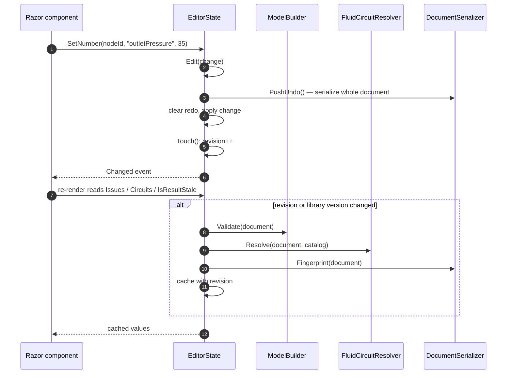
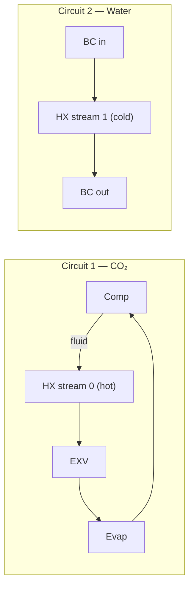

# 4 · Editing and Validation

> **Summary.** `EditorState` (`Core/Editing/EditorState.cs`, one per web circuit / desktop window) is the
> single entry point for changing the document. Every change goes through `Edit(...)`, which stores an undo
> snapshot, applies the change, bumps a revision counter and raises `Changed`. Validation, fluid-circuit
> resolution and the fingerprint are computed lazily and cached per revision. `ConnectionRules` decides
> which ports may be connected.

**Contents**
- [EditorState responsibilities](#editorstate-responsibilities)
- [The edit cycle](#the-edit-cycle)
- [Edit operations](#edit-operations)
- [Undo and redo](#undo-and-redo)
- [Connection rules](#connection-rules)
- [Fluid circuits](#fluid-circuits)
- [Validation](#validation)

---

## EditorState responsibilities

| Area | Members |
|------|---------|
| Document | `Document`, `Load`, `New`, `Edit`, the edit helpers below |
| Selection | `SelectedNodeIds`, `SelectedNode`, `SelectedConnectionId`, `Select`, `SelectNodes`, `SelectConnection`, `SelectAll` |
| Validation | `Issues`, `IssuesFor(nodeId)`, `Circuits`, `FluidOf(nodeId, stream)` |
| Solving | `SolveAsync`, `EstimateStartAsync`, `CancelSolve`, `Result`, `IsSolving`, `ResidualHistory`, `IsResultStale`, `IsResultMuted`, `Energy` |
| Studies | `EditStudy`, `AddStudyVariable`, `RunStudyAsync`, `CancelStudy`, `StudyResult`, `StudyProgress`, `IsStudyStale`, `ApplyStudyPoint`, `StudyRequested` event |
| Undo | `Undo`, `Redo`, `CanUndo`, `CanRedo` |
| Notification | `Changed` event — the UI re-renders on it |

**Rule:** UI code never changes `Document` directly. Always use an `EditorState` method or `Edit(...)`,
otherwise undo, staleness and re-rendering break.

## The edit cycle

Validation is **lazy**: an edit only bumps the revision; the work happens the next time issues, circuits
or the fingerprint are read, and only once per revision. The cache is also invalidated when the
compressor library changes on disk (it affects warnings, not the document).

## Edit operations

| Method | What it does |
|--------|--------------|
| `AddNode(typeId, x, y)` | Creates a node from the descriptor's defaults with a unique name |
| `MoveNodes(positions)` | Moves nodes; shaped routes between nodes that move together move with them |
| `SetConnectionPoints(id, points)` | Stores a user-shaped route (null resets it) |
| `RemoveSelection()` | Deletes selected nodes (and their connections) or the selected connection |
| `Connect(a, b)` | Checks `ConnectionRules`; on success adds the connection, makes the second circuit adopt the first's fluid, and for signal connections selects a fitting measured quantity. Returns an error string otherwise |
| `SetNumber`, `SetCoefficients`, `SetChoice` | Parameter changes. `SetChoice` also runs the parameter's `OnChosen` inside the same edit |
| `RunParameterAction(nodeId, key)` | Runs a parameter button such as "Reload from library" |
| `AddGroupItem`, `RemoveGroupItem` | Repeat groups; removing shifts later items' values, ports, connections and study variables |
| `Rename`, `RotateSelection`, `FlipSelection` | Cosmetic |
| `SetCircuitFluid(stream, fluid)` | Sets the fluid of a whole circuit |
| `SetDocumentName` | |
| `SetEnergyRole` | "Counts as" override |
| `AddGuess`, `SetGuess`, `RemoveGuess`, `ClearGuesses`, `SetGuessesFromResult` | Solver start guesses |

## Undo and redo

- Snapshot-based: the undo stack holds the **whole document serialised as JSON** before each edit; at
  most 200 entries (`MaxUndo`).
- `Undo` pushes the current state onto the redo stack and restores the snapshot; `Redo` the reverse.
- Restoring deserialises (so migrations run, harmlessly), prunes the selection to nodes that still exist,
  and bumps the revision.
- `Load` and `New` clear both stacks and drop the solve and study results.
- Selection is **not** part of undo.

Snapshots are simple and robust (no inverse operations to get wrong); documents are small, so the memory
cost is fine.

## Connection rules

`Building/ConnectionRules.TryConnect(document, catalog, a, b)` accepts the two ports in either order and
returns a normalised `ConnectionProposal` or a readable reason:

| Situation | Result |
|-----------|--------|
| Same port twice | "A port cannot be connected to itself." |
| Signal input ↔ signal input | refused — connect an input to a fluid port to measure it |
| Signal output ↔ anything but a signal input | refused |
| Operator measuring its own output | refused |
| Signal input already connected | refused |
| Signal input ↔ fluid port or signal output | **Signal** connection, `From` = source, `To` = input |
| Fluid port already connected | "A fluid port can only have one connection." |
| Inlet ↔ inlet, outlet ↔ outlet | refused |
| Fluid ↔ fluid otherwise | **Fluid** connection, normalised outlet → inlet |

The canvas shows refused connections as a toast with the reason.

## Fluid circuits

`Building/FluidCircuits.cs` groups every stream (`StreamRef(NodeId, Stream)`) into **circuits** with
union-find over fluid connections. All streams of a circuit must use one fluid.

- A `FluidCircuit` with members of different fluids is a **conflict** (e.g. right after connecting two
  circuits) and is reported by validation and coloured on the canvas.
- `Connect` resolves the common case automatically: the joined circuit adopts the first circuit's fluid.
- `SetCircuitFluid` changes a whole circuit at once (inspector fluid picker).
- The energy balance uses circuits to find the "cycle stream" of a heat exchanger.

## Validation

`ModelBuilder.Validate(document)` returns `ValidationIssue(Severity, Message, NodeId?, ParameterKey?,
PortKey?, ConnectionId?)`. Issues with a node or parameter are shown on that node / input field and in the
Problems tab.

Checks, in order:

1. Empty document (error).
2. Duplicate names (warning), unknown types, empty names (errors).
3. For each `ParameterInstance`: required values present, finite, within `Min`/`Max`; coefficient counts.
4. Each descriptor's `Check` (e.g. EN 12900 model drift warnings).
5. Start guesses (`StartGuesses.Check`).
6. Required ports connected.
7. Connections pointing to missing ports; signal inputs' `CheckSource` (does the source provide the
   selected quantity?).
8. Signal-operator loops (depth-first search, `FindSignalLoop`).
9. Fluid conflicts between circuits.

`Validate` is cheap — it never builds backend components or calls CoolProp — so it runs after every edit.
Errors that only appear when actually building the backend (constructor argument checks, CoolProp
rejecting a fluid name) are reported by `ModelBuilder.Build` at solve time; see
[Solving](05-solving-and-results.md#modelbuilder).
