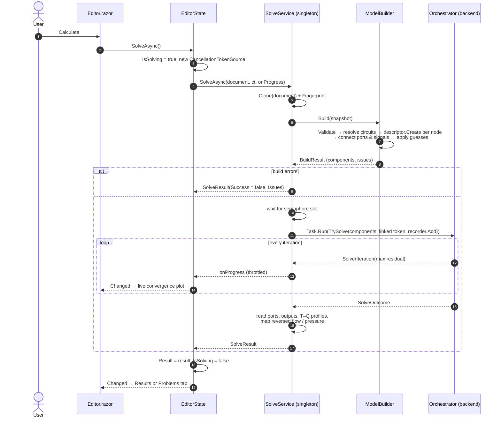
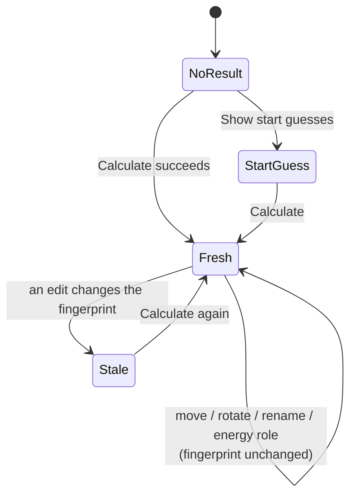

# 5 · Solving and Results

> **Summary.** Pressing *Calculate* calls `EditorState.SolveAsync`, which hands a snapshot of the document
> to the singleton `SolveService`. The service builds fresh backend components with `ModelBuilder.Build`,
> waits for a concurrency slot, runs `Orchestrator.TrySolve` on a background thread with a timeout and
> throttled progress callbacks, and packs everything the UI needs into a `SolveResult` tagged with the
> document's fingerprint. Energy totals and the p-h diagram are derived from that result.

**Contents**
- [End-to-end sequence](#end-to-end-sequence)
- [ModelBuilder](#modelbuilder)
- [SolveService](#solveservice)
- [SolveResult](#solveresult)
- [Stale and muted results](#stale-and-muted-results)
- [Energy balance](#energy-balance)
- [Flow direction for display](#flow-direction-for-display)
- [p-h diagram](#p-h-diagram)

---

## End-to-end sequence

## ModelBuilder

`Building/ModelBuilder.cs` turns a `SystemDocument` into backend components.

`Build(document)`:

1. Runs `Validate`; any error ⇒ no build.
2. Resolves fluid circuits to get each stream's fluid.
3. For each node: `descriptor.Create(new BuildContext(node, descriptor, fluids))`. Exceptions become issues
   on the right field:
   - `ParameterException(key, …)` → that parameter;
   - `ArgumentException` whose `ParamName` matches a parameter → that parameter;
   - CoolProp errors (e.g. unknown fluid) → the node.
4. Connects ports: fluid connections with `Port.ConnectTo`; signal connections link the `SignalPort` to the
   source's `SignalOutput` or to the source port's `SignalTapIn`.
5. Applies start guesses (`ApplyGuesses`) at port, stream or component scope.
6. Returns `BuildResult(Components, ComponentsByNode, Issues)`; `Success` = no errors and at least one
   component.

Because components are rebuilt every time, the backend objects never outlive one solve and the editor
never mutates them.

## SolveService

`Solving/SolveService.cs` — one instance shared by all users of a web server.

| `SolveOptions` | Default | Purpose |
|----------------|---------|---------|
| `Timeout` | 240 s | Linked cancellation token; a timed-out solve fails with a message |
| `MaxConcurrentSolves` | max(1, CPU count / 2) | `SemaphoreSlim` — protects a shared server |
| `ProgressInterval` | 10 iterations | Progress callback frequency… |
| `MinProgressPeriod` | 100 ms | …but no more often than this |

Methods:

- `SolveAsync(document, ct, onProgress)` — full solve, as above.
- `EstimateStartAsync(document, ct)` — debug path: runs only `Orchestrator.EstimateStartValues` and returns
  a result with `IsStartGuess = true`, so the UI can show the start values on the canvas ("Show start
  guesses" button).

## SolveResult

| Member | Meaning |
|--------|---------|
| `Success`, `Message` | Outcome and solver message |
| `Ports` | node id → port key → `PortResult(MassFlow, Pressure, Temperature, Enthalpy)` |
| `Outputs` | node id → `OutputValue`s from the descriptor's `ReadOutputs` (power, duty, control error…) |
| `TemperatureProfiles` | node id → `TemperatureProfile` for heat exchangers |
| `Issues`, `Warnings` | Build issues and start-guess warnings |
| `ReversedFlows` | Ports with reversed flow (`ReversedFlowException`) — highlighted on the canvas |
| `ReversedPressureNodes` | Nodes with a pressure rise across a valve/ejector (`ReversedPressureException`) |
| `IsStartGuess` | Only start values, not a solution |
| `Fingerprint` | Fingerprint of the solved document |
| `ResidualHistory`, `Duration` | Convergence plot data, timing |

When the solver converged to an invalid state (reversed flow or pressure), `Success` is false but the port
states are filled in, so the UI can show *where* the problem is. When it did not converge, the last
iterate is shown with an "unconverged" notice.

## Stale and muted results

- `IsResultStale` = result fingerprint ≠ current document fingerprint.
- `IsResultMuted` = stale **or** a start-guess result. Muted results are drawn greyed out.

Layout, names, the study and energy roles are excluded from the fingerprint
([details](02-document-model.md#fingerprint)), so they never make results stale.

## Energy balance

`Solving/EnergyBalance.cs` computes an `EnergySummary` from a successful result:

$$Q_\text{added} = \dot m_{in}\,(h_{out} - h_{in})$$

per component, classified by its descriptor's `EnergyKind` (or the node's `EnergyRole` override):

| Role | Counted as |
|------|------------|
| `Power` (compressors, pump) | power input |
| `Heat` (fixed outlet temperature, UA evaporator) | heat input if Q > 0, heat output if Q < 0 |
| `Exchanger` | as `Heat`, on the cycle stream — only when the two streams are in different circuits |
| Override `HeatInput` / `HeatOutput` / `PowerInput` | measured on stream 1 between inlet and outlet |
| `Ignore` / `None` | not counted |

`EnergySummary` has `HeatIn`, `HeatOut`, `PowerIn`, `CopHeating = HeatOut / PowerIn`,
`CopCooling = HeatIn / PowerIn`, and `Imbalance = HeatIn + PowerIn − HeatOut` (≈ 0 for a closed cycle with
every exchange counted — a useful sanity check). `DescribeAuto` produces the inspector text explaining how
`Auto` classified a node.

## Flow direction for display

`Solving/FlowDirection.cs` converts the backend's sign convention (positive *into* the component) to what
the user expects (positive in the port's design direction), for tables, tooltips and CSV export.

## p-h diagram

`Charts/PhDiagram.cs` — `PhDiagramBuilder.Build(document, catalog, result, views)` returns one `PhChart`
per distinct fluid:

- **Saturation dome** and **isotherms**, cached per fluid (`ConcurrentDictionary`), computed with HEOS.
- **States**: the fluid ports of each stream of that fluid; **processes**: inlet → outlet pairs within a
  stream.
- **Default view**: from the triple-point pressure (or p_crit/100) to 1.4·p_crit, widened to include all
  states; enthalpy padding −8 % / +30 %. Logarithmic pressure axis.
- **Zoom**: a `PhView` per fluid, clamped to valid ranges; inside a zoom the dome is refined and isotherm
  spacing becomes finer. `NiceStep` picks ticks of 1, 2 or 5 × 10ⁿ.
- Unknown fluids produce an error message on the chart instead of an exception.

The Razor view and the JS zoom/pan handling are described in [User interface](08-ui.md#p-h-diagram).
