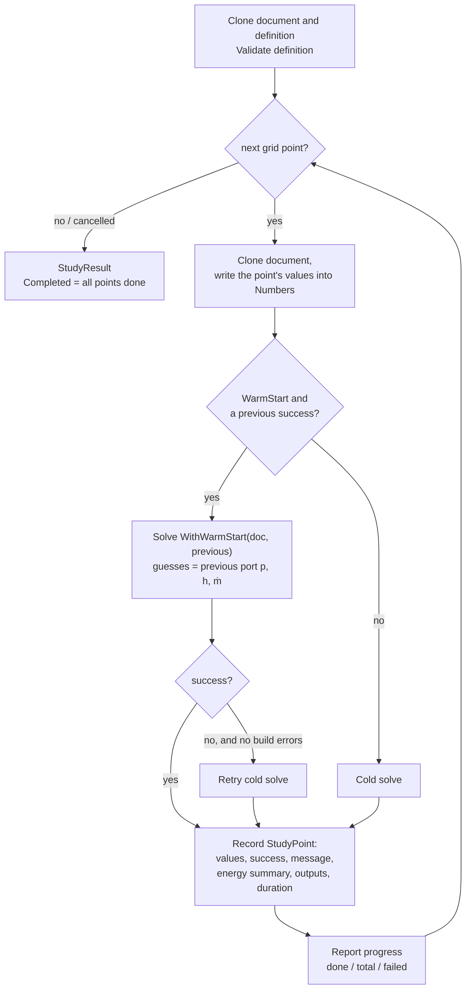

# 6 · Parametric Studies

> **Summary.** A study varies one or more numeric parameters over a full grid of combinations, solves every
> point, and records energy totals plus chosen port quantities and component outputs. Points are solved
> one after another; with *warm start* each point starts from the previous point's solution, falling back to
> a cold solve if that fails. The setup is saved in the document (`SystemDocument.Study`) but does not
> affect single calculations.

**Contents**
- [Definition](#definition)
- [The grid](#the-grid)
- [Running a study](#running-a-study)
- [Results and staleness](#results-and-staleness)
- [Editor integration](#editor-integration)

---

## Definition

`Studies/StudyDefinition.cs`:

| Type | Fields |
|------|--------|
| `StudyVariable` | `NodeId`, `ParameterKey` (may be `key#n` for a repeat-group item), `Start`, `End`, `Steps`, `Spacing` (`Linear` / `Logarithmic`) |
| `StudyOutput` | A port quantity (`PortQuantity`: ṁ, p, T, h at a node's port) or a component output matched by its `Label` |
| `StudyDefinition` | `Variables`, `Outputs`, `WarmStart` (default true) |

Limits: `MaxPoints = 5000`; above `LargeStudy = 200` points the UI asks for confirmation.

`Validate(document, catalog)` reports missing or inactive parameters, too few steps, non-positive bounds
with logarithmic spacing, and duplicate variables.

## The grid

`Grid()` returns the Cartesian product of all variables' values, **first variable varying slowest**:

```
Variables: A = {1, 2}, B = {10, 20, 30}
Points:    (1,10) (1,20) (1,30) (2,10) (2,20) (2,30)
```

`PointCount()` is the product of the step counts. Logarithmic spacing distributes values evenly in
log-space between `Start` and `End`.

Varying the slowest variable first keeps consecutive points close together, which is what makes warm
starting effective.

## Running a study

`StudyRunner.RunAsync(document, definition, progress, ct)` (`Studies/StudyRunner.cs`):



- `WithWarmStart` replaces **every** node's start guesses with the previous point's solved port states —
  the neighbouring solution is a better start than the user's own guesses.
- A failed point does not stop the study; it is recorded with its message and the next point starts from
  the last *successful* result.
- Cancelling returns the points calculated so far with `Completed = false`.
- Each solve goes through the shared `SolveService`, so the concurrency limit and timeout apply per point.

## Results and staleness

`StudyResult` holds a copy of the definition and of the document (for labels and units), the
`StudyPoint`s, `Completed`, `Duration` and a `Fingerprint`.

`StudyRunner.Fingerprint(document, definition)` covers everything that affects the results **except the
varied parameters themselves**. Applying a study point to the document (which changes those parameters)
therefore does not mark the study as out of date, while any other change does
(`EditorState.IsStudyStale`).

## Editor integration

| `EditorState` member | Purpose |
|----------------------|---------|
| `AddStudyVariable(nodeId, key)` | Adds a variable spanning ±20 % of the current value in 5 steps and raises `StudyRequested` (opens the study tab). Bound to the ⊕ button next to number fields |
| `EditStudy(change)` | Undoable change to the definition |
| `RunStudyAsync()`, `CancelStudy()` | Run / cancel; `StudyProgress` updates live |
| `StudyResult`, `IsStudyRunning`, `IsStudyStale` | State for the panel |
| `ApplyStudyPoint(result, point)` | Writes the point's values into the document (undoable) |

The study panel shows the results as a table or a chart and exports CSV; see
[User interface](08-ui.md#bottom-panel).
