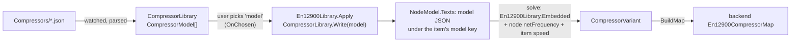

# 7 · Compressor and Example Libraries

> **Summary.** Two data folders ship with the program and are watched for changes at run time:
> `Compressors/` (EN 12900 compressor models as `.json`) and `Examples/` (example systems as
> `.cycle.json`). Choosing a compressor model **embeds the whole model** in the node, so saved documents
> never depend on the library. Both folders live in `CycleCalculatorUi.Core/` and are copied next to the
> program on build and publish; the web host can point to other folders.

**Contents**
- [Where the data lives](#where-the-data-lives)
- [Compressor library](#compressor-library)
  - [File format](#file-format)
  - [From file to solver](#from-file-to-solver)
  - [Embedding and drift](#embedding-and-drift)
- [Example library](#example-library)

---

## Where the data lives

| | Source folder | At run time | Web override |
|---|---------------|-------------|--------------|
| Compressors | `CycleCalculatorUi.Core/Compressors/` | `CompressorLibrary.ShippedDirectory` = `<app>/Compressors` | `CompressorLibrary:Directory` |
| Examples | `CycleCalculatorUi.Core/Examples/` | `ExampleLibrary.ShippedDirectory` = `<app>/Examples` | `Examples:Directory` |

Both libraries:
- read all matching files recursively,
- watch the folder (files added, changed or removed show up without a restart),
- are thread-safe singletons shared by all editor sessions,
- collect unreadable files in `Problems` instead of throwing.

Shipped content: BITZER R744 compressors (4FTE-30K, 4HTE-15K, 4HTE-20K, 4ESL-9K in `BITZER_R744.json`) and
three examples (Bitzer fender comparison; LP ejector system with two pumps; MT, LT and IT with HP ejector
and floating receiver).

## Compressor library

### File format

Full reference: `CycleCalculatorUi.Core/Compressors/README.txt`. In short — a file holds one model or a
`models` array; settings cascade **file → model → variant**:

```jsonc
{
  "manufacturer": "Acme",               // optional, shown before the name
  "refrigerant": "CarbonDioxide",       // optional, CoolProp name
  "dischargeVariable": "pressure",      // "pressure" (bar a) or "saturationTemperature" (°C)
  "nominalSuperheat": 10,               // K, suction superheat of the polynomials
  "massFlowUnit": "kg/h",               // "kg/h" (default) or "kg/s"
  "powerUnit": "W",                     // "W" (default) or "kW"
  "nominalVoltage": 400,                // V, required when "current" is given
  "models": [
    {
      "name": "AC-100",
      "variants": [
        // fixed speed, one set at the net frequency
        { "speed": "fixed", "netFrequency": 50,
          "massFlow": [c1, …, c10], "power": [c1, …, c10], "current": [c1, …, c10] },

        // variable speed, interpolated between measured frequencies
        { "speed": "variable", "netFrequency": 50, "scaling": "interpolate",
          "frequencies": [
            { "frequency": 30, "massFlow": […], "power": […] },
            { "frequency": 50, "massFlow": […], "power": […] },
            { "frequency": 70, "massFlow": […], "power": […] } ] },

        // variable speed from one set, scaled linearly with frequency
        { "speed": "variable", "netFrequency": 60, "scaling": "linear",
          "massFlow": […], "power": […] }
      ]
    }
  ]
}
```

- The ten coefficients follow EN 12900 (see [backend: EN 12900](../CycleCalculator/docs/05-fluids-and-en12900.md#the-polynomial)).
- `scaling` defaults to linear for one set, interpolate for several.
- A variant without `netFrequency` applies to any net frequency.
- Comments and trailing commas are allowed; model names must be unique.
- The older format (`massFlow`/`power`/`current`/`nominalFrequency` directly on the model) is still read.

### From file to solver



Types (`Catalog/CompressorLibrary.cs`):

| Type | Content |
|------|---------|
| `CompressorModel` | `Name`, `File`, `Refrigerant`, `DischargeVariable`, `NominalSuperheat`, `MassFlowUnit`, `PowerUnit`, `Variants` |
| `CompressorVariant` | `Speed` (fixed / variable), `NetFrequency?`, `NominalVoltage?`, `Scaling`, `Points` |
| `CompressorPoint` | `Frequency`, `MassFlow[10]`, `Power[10]`, `Current?` |

The variant is chosen by the node's `netFrequency` choice (50/60 Hz) and each compressor item's
`speedControl`; `netVoltage` scales the current. New EN 12900 nodes start with the first library model
(`ComponentDescriptor.Initialize`).

### Embedding and drift

- There is **no manual polynomial input** in the editor. Choosing a model embeds it whole, as JSON in the
  library file format, under the model key in `NodeModel.Texts`. Documents are self-contained.
- Models that are not in the library (older files, examples) simply use their stored data.
- `En12900Library.Check` warns when the embedded data differs from the library model of the same name
  ("drift"), and when data is missing or the refrigerant does not match. A **"Reload from library"**
  `ParameterAction` re-embeds the current library version.
- `ComponentCatalog.Default` uses `CompressorLibrary.Empty`; the examples embed
  `En12900Library.ExampleCompressor`, which is also the fallback for old files without polynomials.
- Format-2 documents with polynomial parameters are converted on load
  (`DocumentSerializer.EmbedCompressorModels`, see [migrations](02-document-model.md#versions-and-migrations)).

## Example library

`Examples/ExampleLibrary.cs`:

- Reads every `*.cycle.json` in the folder, ordered by **file name** (prefix a number to set the order),
  listed in the editor's *Open example…* menu by **document name**.
- `ExampleSystem.Create()` returns a fresh clone, safe to edit. `Find(title)` looks one up by name.
- **To add or change an example:** build it in the editor and save it into
  `CycleCalculatorUi.Core/Examples/`. Tests load the shipped examples through `Tests/ShippedExamples.cs`,
  so a broken example fails the tests.
