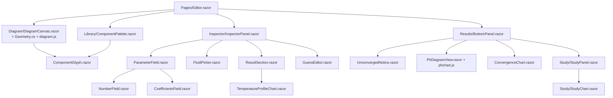
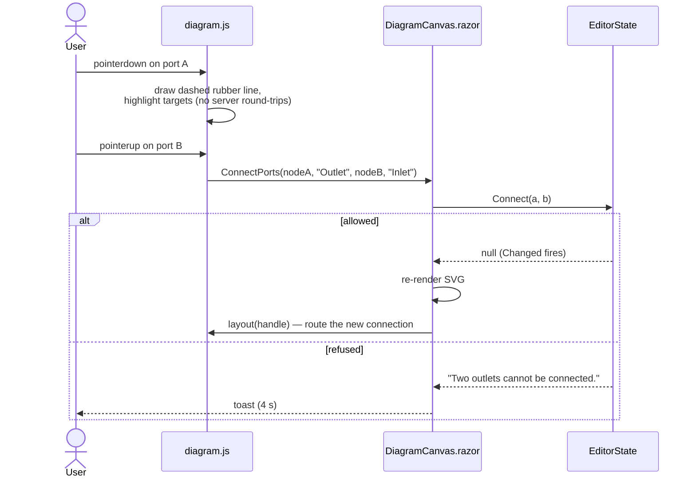

# 8 · User Interface

> **Summary.** The whole app is one Razor page, `Shared/Pages/Editor.razor`: a toolbar, a component palette,
> an SVG canvas, an inspector, and a collapsible bottom panel with Problems, Results, p-h diagram,
> Convergence and Parametric study tabs. Pointer-heavy interaction (dragging, routing, zooming) runs in
> JavaScript (`diagram.js`, `phchart.js`) and reports only finished gestures back to C#, which keeps Blazor
> Server smooth over the network. Every change goes through `EditorState`.

**Contents**
- [Layout](#layout)
- [Component map](#component-map)
- [Toolbar](#toolbar)
- [Palette](#palette)
- [Canvas](#canvas)
- [Inspector](#inspector)
- [Bottom panel](#bottom-panel)
- [p-h diagram](#p-h-diagram)
- [Blazor ↔ JavaScript interop](#blazor--javascript-interop)
- [Drafts and autosave](#drafts-and-autosave)
- [Styling](#styling)

---

## Layout

```
┌──────────────────────────────────────────────────────────────────────────────────────┐
│ New  Open  Save  Export CSV  Open example…  ↶ ↷  − + Fit  Values │ status │ Calculate │  toolbar
├───────────┬──────────────────────────────────────────────────────┬───────────────────┤
│ Palette   │                                                      │ Inspector         │
│ [search]  │                 Canvas (SVG)                         │                   │
│ Boundaries│     ┌────┐      ┌────┐      ┌────┐                    │  selected node:   │
│ Compress. │     │Comp├──────┤ GC ├──────┤EXV │                    │  name, parameters │
│ Pumps     │     └─┬──┘      └────┘      └─┬──┘                    │  fluid, energy    │
│ Valves    │       └──────────┤Evap├───────┘                      │  results, guesses │
│ Heat exch.│                                                      │                   │
│ Flow      │                                                      │                   │
│ Signals   │                                                      │                   │
├───────────┴──────────────────────────────────────────────────────┴───────────────────┤
│ Problems │ Results │ p-h diagram │ Convergence │ Parametric study                        │  bottom panel
└──────────────────────────────────────────────────────────────────────────────────────┘
```

Below 900 px width the palette collapses to 64 px icons and the inspector narrows to 260 px.

## Component map



Other Shared files: `Format.cs` (number formatting), `ResultExport.cs` and `StudyExport.cs` (CSV),
`Components/ChartAxis.cs` (axis ticks), `Services/` (file and draft abstractions).

## Toolbar

| Control | Behaviour |
|---------|-----------|
| **New** | Confirms in a popover when the canvas is not empty, then `State.New()` |
| **Open** | Desktop: native dialog. Web: `<InputFile accept=".json,.cycle.json">`, ≤ 10 MB; read errors show a toast |
| **Save** | Writes `<name>.cycle.json` (unsafe characters → `_`); disabled when empty |
| **Export CSV** | `<name> results.csv`: one row per port (ṁ in design direction, p, T, h), then heat/power totals and COPs |
| **Open example…** | Select filled from `ExampleLibrary`; resets to the placeholder after each pick |
| **Undo / Redo** | `State.Undo()` / `State.Redo()` |
| **Zoom − / + / Fit** | Factor 1.25; Fit frames all nodes |
| **Values** | Toggles p, T, ṁ labels on the canvas |
| **Status pill** | Calculating · N problems · showing start guesses · reversed flow · pressure rise · failed · results out of date · solver message |
| **Cancel** | While a solve runs |
| **Show start guesses** | Debug: `EstimateStartAsync`, shows the solver's start values |
| **Calculate** | `State.SolveAsync()`; afterwards switches to Results (or Problems on failure) |

## Palette

`Library/ComponentPalette.razor` lists descriptors grouped by category (Boundaries, Compressors, Pumps,
Valves, Heat exchangers, Flow, Signals) with a search box filtering by name or category. Each item carries
`data-palette-type`; `diagram.js` handles dragging it onto the canvas (or a click, which adds it in the
middle of the view).

## Canvas

`Diagram/DiagramCanvas.razor` renders an SVG: dot grid, then connections, then nodes with their ports.
Blazor renders the *structure*; `diagram.js` computes connection paths from the rendered port positions
(orthogonal auto-routing, or through the user's stored corner points).

CSS classes carry state: fluid colour per circuit (`fluid-<name>`), fluid conflicts, reversed flow,
pressure rise, errors, missing ports, stale results, signal vs fluid lines. Port tooltips show p, T, h, ṁ.
An empty canvas shows a "Start a new system" panel with example links.

### Mouse

| Action | Effect |
|--------|--------|
| Drag palette item / click it | Add component (snapped to the 16 px grid) |
| Click node (Shift/Ctrl/Meta to add) | Select |
| Drag node | Move it (or the whole selection); shaped routes between moved nodes move along |
| Drag port → port, or click port then port | Connect (dashed rubber line, target highlight); Esc or empty click cancels |
| Drag on empty canvas | Rubber-band select (Shift adds); plain click clears |
| Click connection, drag a segment or corner | Reshape route; stays orthogonal, snaps to an 8 px half-grid, aligns with port stubs within 6 px |
| Right/middle drag, Alt+drag, Shift+wheel | Pan |
| Wheel | Zoom around pointer (0.2×–4×) |

### Keyboard

| Key | Action |
|-----|--------|
| Del / Backspace | Delete selection |
| Esc | Clear selection |
| R / Shift+R | Rotate +90° / −90° |
| F | Flip |
| Ctrl+Z, Ctrl+Y / Ctrl+Shift+Z | Undo, redo |
| Ctrl+A | Select all |
| Ctrl+S | Save |
| Ctrl+O | Open (desktop only) |

Meta works in place of Ctrl. Keys are ignored while a text field has focus.

## Inspector

`Inspector/InspectorPanel.razor` depends on the selection:

| Selection | Shows |
|-----------|-------|
| **One node** | Glyph, type, editable name, description; rotate / flip / delete; node issues; **parameters** built from the descriptor (`ParameterField` → `NumberField`, choice select, `CoefficientsField`), nested parameters, repeat groups with "+ Add …" / "Remove"; **fluid** per stream (`FluidPicker`); **energy role** ("Counts as"); **results** (`ResultSection`: port table, outputs, T–Q chart for heat exchangers); **start guesses** (`GuessEditor`) |
| **Several nodes** | Count; rotate / flip / delete |
| **A connection** | From/to ports, solved ṁ/p/T/h, "Reset route", "Delete connection" |
| **Nothing** | System name, default fluid, a short how-to |

Notes:
- `NumberField` accepts `,` or `.` as decimal separator; an empty optional field means "free". The ⊕
  button adds the parameter to the study.
- `CoefficientsField` accepts values pasted from a spreadsheet.
- `GuessEditor` can copy a value from the last result.

## Bottom panel

`Results/BottomPanel.razor`, collapsible, five tabs:

| Tab | Content |
|-----|---------|
| **Problems** | Validation issues + solver failure, with error/warning counts; click selects the node |
| **Results** | `UnconvergedNotice` if failed; energy totals (heat in, heat out, power in, COP heating, COP cooling — tooltip explains each node's classification); table of all ports (click selects) |
| **p-h diagram** | See below |
| **Convergence** | `ConvergenceChart`: live log plot of the max residual per iteration |
| **Parametric study** | `StudyPanel`: variables (from, to, steps 1–1000, linear/log), extra outputs, warm-start toggle, confirmation above 200 points, progress + cancel; results as a table (each row has **Apply**) or a chart (`StudyChart`: metric vs x-variable, one line per other variable); "out of date" badge; CSV export |

## p-h diagram

`Results/PhDiagramView.razor` renders one tab per fluid with the saturation dome, isotherms, process lines
and state dots (data from `PhDiagramBuilder`, see [Solving](05-solving-and-results.md#p-h-diagram)).
Hover shows a tooltip, click selects the component.

Zoom: wheel over the plot zooms both axes; below the plot only h; left of the plot only p. Drag or
Shift+wheel pans. Double-click or "Reset zoom" resets. The view is kept per fluid and reset when another
document is loaded.

## Blazor ↔ JavaScript interop

All modules are imported from `./_content/CycleCalculatorUi.Shared/<file>.js`.

### `diagram.js` (used by `DiagramCanvas.razor`)

| Direction | Calls |
|-----------|-------|
| C# → JS | `init(svg, dotnetRef)` → handle; `layout(handle)` after each render; `fit(handle)`; `zoom(handle, factor)`; `dispose(handle)` |
| JS → C# (`[JSInvokable]`) | `DropComponent(typeId, x, y)`, `SelectNode`, `SelectNodes`, `ClearSelection`, `SelectConnection`, `MoveNodes(NodeMove[])`, `SetConnectionPoints(id, RoutePoint[])`, `ConnectPorts(nodeA, portA, nodeB, portB)`, `OnKey(key, ctrl, shift)` |



Gestures are reported **once they finish** — during a drag nothing crosses the SignalR connection. Before
handling a pointer-down, `commitFocusedField()` blurs any focused input so its change event commits first.

### `phchart.js` (used by `PhDiagramView.razor`)

- C# → JS: `init(container, dotnetRef)`, `dispose`.
- JS → C#: `SetView(fluid, hMin, hMax, pMin, pMax, seq)`, `ResetView(fluid, seq)`.
- During a gesture JS transforms the already-drawn layer with a CSS matrix (`[data-zoom-layer]`) for instant
  feedback, and sends the new view 150 ms after the last wheel event (every 300 ms while dragging). A
  sequence number (`data-seq`) and a `MutationObserver` on `data-view` keep the preview and the redrawn
  chart in step.

### `host.js` (used by `Services/BrowserServices.cs`)

- `downloadText(name, content)` — Blob + `<a download>`.
- `loadDraft(key)` — returns bytes read by C# as an `IJSStreamReference` stream (≤ 20 MB), avoiding the
  32 KB SignalR message limit.
- `saveDraft(key, content)` — `localStorage`. Storage failures are swallowed.

## Drafts and autosave

After the first render, `Editor.razor` loads the draft from `IDraftStore` **only if the canvas is empty**
(read errors are ignored). Every `State.Changed` schedules an autosave 800 ms after the last change
(debounced, best effort). Web: browser `localStorage`; desktop: `draft.cycle.json` in the app data folder
(see [Architecture](01-architecture.md#web-vs-desktop-host)).

## Styling

`wwwroot/app.css` is one global stylesheet (no scoped CSS): CSS variables, dark mode via
`prefers-color-scheme`, fluid colours (CO₂, R134a, water, air, …), chart series colours `--series-1..8`, and
the narrow-screen layout.
