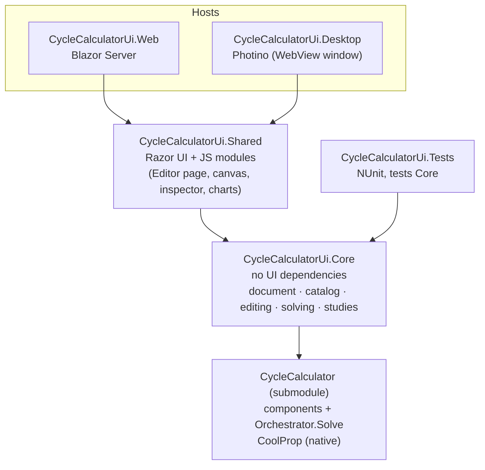
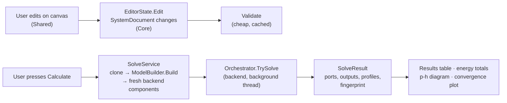

# CycleCalculatorUi — Developer Documentation

> **Summary.** CycleCalculatorUi is a drag-and-drop editor for thermodynamic cycles (refrigeration
> systems, heat pumps, CO₂ racks). You draw components and connections on a canvas, set parameters, press
> *Calculate*, and get port states, energy totals, a p-h diagram and parametric studies. It is a Blazor UI
> hosted either as a web server (Blazor Server) or as a desktop app (Photino), on top of the
> **CycleCalculator** solver in the `CycleCalculator/` git submodule.

## Contents

### Frontend (this repository)

| # | Document | What you will learn |
|---|----------|---------------------|
| 1 | [Architecture](01-architecture.md) | Projects and layers, dependency injection, web vs desktop host |
| 2 | [Document model and file format](02-document-model.md) | `SystemDocument`, nodes, connections, repeat groups, `.cycle.json`, migrations |
| 3 | [Component catalog](03-catalog.md) | Descriptors, all built-in components, controllers & measurements, adding a component |
| 4 | [Editing and validation](04-editing-and-validation.md) | `EditorState`, undo/redo, connection rules, validation, fluid circuits |
| 5 | [Solving and results](05-solving-and-results.md) | `ModelBuilder`, `SolveService`, `SolveResult`, energy balance, p-h chart |
| 6 | [Parametric studies](06-studies.md) | Study definition, grid, warm start, applying a point |
| 7 | [Compressor and example libraries](07-libraries.md) | EN 12900 model files, embedding, example systems |
| 8 | [User interface](08-ui.md) | Editor layout, canvas interactions, Blazor ↔ JavaScript interop |
| 9 | [Build and test](09-build-and-test.md) | Commands, test suites, desktop packaging |

### Backend (submodule `CycleCalculator/`)

| # | Document |
|---|----------|
| – | [Backend overview](../CycleCalculator/docs/README.md) |
| 1 | [Core concepts](../CycleCalculator/docs/01-concepts.md) — units, ports, equations |
| 2 | [Component reference](../CycleCalculator/docs/02-components.md) — physics of every component |
| 3 | [Control and signals](../CycleCalculator/docs/03-control-and-signals.md) |
| 4 | [The solver](../CycleCalculator/docs/04-solver.md) — presolve, start values, bounded LM |
| 5 | [Fluids and EN 12900](../CycleCalculator/docs/05-fluids-and-en12900.md) |
| 6 | [Testing and extending](../CycleCalculator/docs/06-testing-and-extending.md) |

## The big picture

## How a calculation flows

The key design choice: **the editor never mutates backend objects.** Backend component parameters are
constructor arguments, so the editor keeps its own model (`SystemDocument`) and rebuilds fresh backend
components from it on every solve.

## Glossary

| Term | Meaning |
|------|---------|
| **Document** | The editable system: `SystemDocument` with its nodes and connections. Saved as `.cycle.json`. |
| **Node** | One placed component on the canvas (`NodeModel`). |
| **Type / descriptor** | What the editor knows about a component type (`ComponentDescriptor`): ports, parameters, how to build it. |
| **Catalog** | All descriptors (`ComponentCatalog`). |
| **Port key** | Name of a port on a node, e.g. `Inlet`, `Outlet2`, `Signal`, `In#2`. |
| **Stream** | One fluid path through a node; heat exchangers have two. |
| **Fluid circuit** | All streams joined by fluid connections; they must share one fluid. |
| **Signal connection** | A measurement link from a fluid port (or a signal output) to a controller's signal input. |
| **Repeat group** | A set of parameters (and ports) a node can hold several copies of, e.g. parallel compressors. |
| **Fingerprint** | A hash of everything that affects the calculation; used to tell whether results are stale. |
| **Study** | A parametric sweep over a grid of parameter values. |
| **Draft** | The autosaved current document, restored at start-up. |
